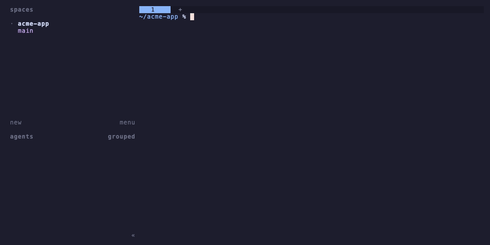

# herdr-new-workspace-extended

A [herdr](https://herdr.dev) plugin that extends **new workspace**. Press the new workspace key and pick how to start:

- **With a name**: create a regular workspace, like the built-in command
- **From a GitHub issue**: pick an open issue with fzf, confirm a branch name, and open a worktree workspace branched from the latest default branch
- **From a GitHub pull request**: pick an open pull request and open a worktree workspace on its branch. The branch is fetched and set to track `origin` if it is not local yet. Pull requests from forks are not supported yet



Outside a git repository, or in one without an `origin` remote, the picker skips the menu and asks for a name.

If the chosen branch already has a worktree, the picker opens it instead of creating another.

> Status: 0.1.0. Tested with herdr 0.9.5 on macOS. Linux should work but has not been tried.

## Requirements

- herdr 0.9.5 or later
- bash
- git
- [fzf](https://github.com/junegunn/fzf)
- [jq](https://jqlang.org)
- [GitHub CLI](https://cli.github.com) (`gh`), signed in to the repository's host

## Setup

1. Install the plugin:

   ```sh
   herdr plugin install U5K492/herdr-new-workspace-extended
   ```

2. Bind the new workspace key to the plugin in `~/.config/herdr/config.toml`, and move the built-in command to another key so you can still reach it:

   ```toml
   [keys]
   new_workspace = "prefix+ctrl+n"

   [[keys.command]]
   key = "prefix+shift+n"
   type = "plugin_action"
   command = "u5k492.new-workspace-extended.new"
   description = "new workspace (extended)"
   ```

   If your config still sets `new_workspace = "prefix+shift+n"`, herdr keeps the built-in binding and disables this one.

3. Reload the config:

   ```sh
   herdr server reload-config
   ```

## Development

```sh
mise install
herdr plugin link "$PWD"
bats test
NWE_TEST_BASH=/bin/bash bats test
shellcheck bin/*.sh lib/*.sh sources/*.sh test/stubs/* demo/*.sh demo/bin/*
```

If you installed the plugin from GitHub, run `herdr plugin uninstall u5k492.new-workspace-extended` before linking your clone.

`mise install` installs the versions of bats and shellcheck pinned in `mise.toml`. Without mise, use `brew install bats-core shellcheck`.

The popup runs `bash` from the herdr server's `PATH`, which can be macOS's `/bin/bash` 3.2. Keep scripts compatible with bash 3.2, and run the specs with `NWE_TEST_BASH=/bin/bash` to check.

Functions in `lib/` mostly run inside command substitutions, where bash turns `set -e` off. End each step that can fail with `|| return 1` so a failure stops the picker instead of carrying on with stale values.

### Recording the demo

When the picker looks different, record `demo/demo.gif` again with [VHS](https://github.com/charmbracelet/vhs):

```sh
brew install vhs
demo/record.sh
```

`demo/record.sh` builds a throwaway home with a sample repository, links your clone into a separate herdr server there, and plays `demo/demo.tape`. In that server, `gh` is `demo/bin/gh`, which returns sample issues and pull requests. Your own herdr session and GitHub account are not touched, and the home is removed when the recording ends.

### Layout

- `bin/open-picker.sh`: the `new` action. Opens the picker popup and passes the invocation context to it
- `bin/pick.sh`: runs inside the popup
- `lib/`: functions sourced by `bin/pick.sh`
- `sources/`: where a worktree workspace can start from. A source is listed in `lib/sources.sh` with its menu title, and its menu key is its name. `bin/pick.sh` calls four functions it defines:
  - `nwe_<name>_available <repo>` succeeds when the repository can use the source. It must not call the network, since it runs every time the key is pressed
  - `nwe_<name>_items` fetches the candidates
  - `nwe_<name>_choose <items>` lets you pick one with fzf and prints its key
  - `nwe_<name>_resolve <items> <key>` prints the branch, the base (empty to let herdr decide) and the label on three lines

  When `items` or `resolve` fails, show why with `nwe_notice` before returning non-zero. The popup closes as soon as the picker exits, so an error left only on stderr cannot be read
- `demo/`: the VHS tape and scripts that record `demo/demo.gif`
- `test/`: bats specs. `test/stubs/` fakes fzf, gh and herdr, and `test/fixtures/` holds the JSON the gh stub returns. git is real: each spec builds a throwaway origin and clone

### The `nwe` prefix

`nwe` stands for **N**ew **W**orkspace **E**xtended.
Bash has no namespaces, and the files in `lib/` are sourced into the same shell.
To avoid clashing with functions and variables from your shell or from herdr (`HERDR_*`), every function this plugin defines is named `nwe_*`, and every environment variable is named `NWE_*`.

## License

[MIT](LICENSE)
